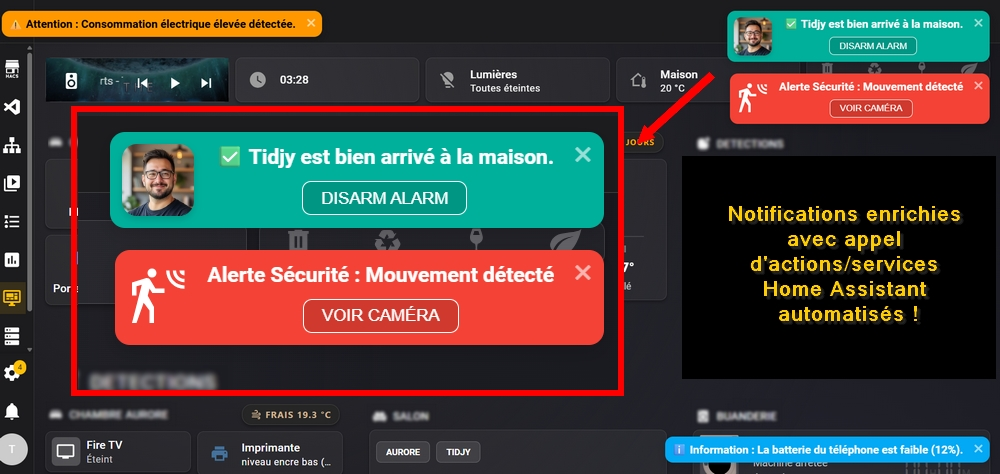

# toABify

**[English](README.md) | Deutsch**

Eine Home Assistant-Integration, die schöne Toast-Benachrichtigungen auf Ihrer Oberfläche anzeigt, basierend auf [Toastify-JS](https://apvarun.github.io/toastify-js/).

[](https://www.home-assistant.io/)
[](https://github.com/arboeh/toABify/releases/latest)
[](https://github.com/arboeh/toABify/actions)
[](https://github.com/arboeh/toABify/blob/main/SECURITY.md)
[](https://github.com/arboeh/toABify/graphs/commit-activity)
[](https://github.com/arboeh/toABify/blob/main/LICENSE)

> **Basierend auf HA-Toastify von TidjyDev (MIT)**. toABify ist kein offizieller Fork: Es teilt die gleiche interne Architektur (Identifikatoren `toastify_event`, `toastify/subscribe`, `/toastify_lib`), ist aber ein eigenständiges Projekt. **Installieren Sie toABify nicht parallel zu HA-Toastify** - die internen Identifikatoren würden Konflikte verursachen.

## ⚡ Schnelltest

Führen Sie dies in **Entwicklerwerkzeuge → Aktionen** aus, um zu prüfen, ob Toasts Ihren Browser erreichen:

```yaml
action: notify.toabify
data:
  message: "Hello from toABify"
  data:
    visibility: all
```

> **Verwenden Sie hier `visibility: all`.** Der Standardwert ist `dashboard`, daher wird ein
> Toast aus den Entwicklerwerkzeugen (Pfad `/developer-tools/...`) sonst überhaupt nicht angezeigt.



## Funktionen
- **HACS-kompatibel**: Einfache Installation und Updates.
- **Anpassbar**: Farbe (Schema oder Hex), Dauer, Position, Schließschaltfläche, Icon/Avatar.
- **Dynamischer Kontrast**: Text wechselt automatisch zwischen Schwarz und Weiß für optimale Lesbarkeit.
- **Intelligente Sichtbarkeit**: Benachrichtigungen nur auf dem Dashboard oder in der gesamten Home Assistant-Oberfläche anzeigen (Einstellungen, Logs, Historie, etc.).
- **Interaktive Schaltfläche**: Eine optionale Schaltfläche, die eine URL öffnet oder **einen Home Assistant-Dienst aufruft** (z. B. Licht ausschalten, zu einem Dashboard navigieren).
- **Nativer Notify-Service**: Vollständig kompatibel mit dem integrierten Benachrichtigungssystem von Home Assistant.

## Installation

### 1. Über HACS (Empfohlen)
1. Öffnen Sie **HACS** in Ihrer Home Assistant-Instanz.
2. Klicken Sie auf die drei Punkte oben rechts → **Benutzerdefinierte Repositorys**.
3. Fügen Sie diese Repository-URL hinzu: `https://github.com/arboeh/toABify`.
4. Wählen Sie die Kategorie **Integration** und klicken Sie auf **Hinzufügen**.
5. Suchen Sie nach "toABify" und installieren Sie es.
6. **Starten Sie Home Assistant neu.**

### 2. Konfiguration
Nach der Installation über HACS ist **keine manuelle Konfiguration** erforderlich.
Die Integration wird als **Config-Entry** eingerichtet:

1. Öffnen Sie **Einstellungen** → **Geräte & Dienste** → **Integration hinzufügen**.
2. Suchen Sie nach **toABify** und folgen Sie dem Einrichtungsassistenten.
3. Der Benachrichtigungsdienst `notify.toabify` ist danach in Automatisierungen und Skripten verfügbar.

## Dienstparameter

`message` ist das einzige Pflichtfeld und steht direkt neben `data:`. Alle folgenden Optionen
gehören in das verschachtelte `data:`:

| Parameter (in `data.data`) | Beschreibung | Standard |
| :--- | :--- | :--- |
| `color` | Farbschema (`success`, `info`, `warning`, `error`, `alert`, `default`) oder Hex-Farbe (`#RGB`, `#RRGGBB`, `#RRGGBBAA`). Ein `#RGB`-Wert wird intern zu `#RRGGBB` erweitert. | `info` |
| `duration` | Dauer in ms (`3000` = 3s). `-1` hält den Toast, bis er weggeklickt wird. `0` fällt auf `5000` zurück. | `5000` |
| `position` | Horizontale Ausrichtung: `left`, `center` oder `right`. | `right` |
| `gravity` | Vertikale Ausrichtung: `top` oder `bottom`. `center` wird akzeptiert, rendert aber oben. | `top` |
| `close` | Schließschaltfläche (`X`) im Toast anzeigen. | `false` |
| `icon` | Bild-URL oder -Pfad (z. B. `/local/avatar.png`) oder MDI-Icon (z. B. `mdi:bell`). | *(leer)* |
| `avatar` | Ersatz für `icon`, wenn `icon` nicht gesetzt ist. | *(leer)* |
| `visibility` | `dashboard` (Lovelace nur) oder `all` (überall in HA, einschließlich Einstellungen und Entwicklerwerkzeugen). | `dashboard` |
| `onClick` | Schaltflächen-Konfiguration. **Nur als Objekt** - siehe [Schaltfläche](#-schaltfläche-onclick). | *(keine)* |
| `button_label` | Ersatz-Beschriftung für die Schaltfläche, verwendet wenn `onClick.label` nicht gesetzt ist. Erscheint als reiner Text, max. 200 Zeichen. | `CLOSE` |
| `callback` | Aktion beim Verschwinden des Toasts. String oder Objekt - siehe [Callback](#-callback). | *(keine)* |
| `oldestFirst` | Stapelreihenfolge für Benachrichtigungen. Keine sichtbare Wirkung. | `true` |

## Schaltfläche (`onClick`)

`onClick` wird nur als **Objekt** akzeptiert, mit diesen Schlüsseln:

| Schlüssel | Beschreibung |
| :--- | :--- |
| `action` | Pfad (`/...`), URL (`http...`) oder Home Assistant-Dienst (`domain.service`). |
| `action_data` | Parameter für den Dienstaufruf (nur mit `domain.service`). |
| `label` | Text der Schaltfläche (max. 200 Zeichen, HTML wird nicht interpretiert). |
| `feedback` | Auf `true` setzen, damit die Beschriftung während der Aktion pulsiert und ein Häkchen erscheint. |

Wichtiges Verhalten:

- Eine Schaltfläche wird nur gerendert, wenn `onClick` gesetzt ist. `onClick: {}` ergibt eine
  reine **CLOSE**-Schaltfläche. `close: true` ist ein anderes Element (das `X` in der Ecke).
- Reihenfolge der Beschriftung: `onClick.label`, dann `button_label`, dann `CLOSE`.
- Ein `action`, der mit `/` oder `http` beginnt, öffnet einen **neuen Browser-Tab**.
- Ein `action` in der Form `domain.service` wird im Frontend mit `action_data` aufgerufen.
- Unbekannte Schlüssel (z. B. `URL`) werden ignoriert und lösen nichts aus.

```yaml
action: notify.toabify
data:
  message: "Das Tor wurde offengelassen! Klick zum Schließen."
  data:
    color: warning
    visibility: all
    close: true
    duration: -1
    onClick:
      action: cover.close_cover
      action_data:
        entity_id: cover.gate_main
```

## Callback

`callback` reagiert, wenn der Toast verschwindet. Es gibt zwei Formen:

**Als String** (`/...` oder `http...`): wird im Browser geöffnet, wenn der Toast verschwindet.
Der Browser kann dies als Popup blockieren.

**Als Objekt** (`action`, `action_data`): ein **serverseitiger Dienstaufruf** nach `duration` ms
- ohne `duration` nach `3000` ms. Bei `duration` kleiner oder gleich `0` wird der Callback
nie ausgeführt.

```yaml
action: notify.toabify
data:
  message: "Backup gestartet"
  data:
    duration: 2000
    visibility: all
    callback:
      action: persistent_notification.create
      action_data:
        message: "Der toABify-Callback wurde ausgeführt."
```

> **Hinweis**: Die generischen Core-Felder `title` und `target` werden vom Notify-Dienst
> akzeptiert, aber von toABify ignoriert.

## YAML-Beispiele (Service-Aufrufe)

In Automatisierungen und Skripten verwenden Sie den Dienst `notify.toabify`:

### Erfolgs-Benachrichtigung
Perfekt, um erfolgreich abgeschlossene Automatisierungen zu bestätigen.
```yaml
action: notify.toabify
data:
  message: "Alarm erfolgreich aktiviert"
  data:
    color: "success"
    duration: 5000
    visibility: all
```

### Voll-HA-Warnung (Rot mit Schließbutton)
Ideal für Fehler oder Sicherheitswarnungen, die sofortige Aufmerksamkeit erfordern.
Sichtbar selbst in den Einstellungsmenüs.
```yaml
action: notify.toabify
data:
  message: "⚠️ Wasserschaden im Küchenbereich erkannt!"
  data:
    color: "#ff5f6d"
    close: true
    duration: -1
    gravity: "bottom"
    visibility: all
```

### Benachrichtigung mit Avatar-Icon
Wissen, wer oder was das Ereignis ausgelöst hat.
```yaml
action: notify.toabify
data:
  message: "Alex ist nach Hause gekommen"
  data:
    avatar: "/local/img/alex_avatar.png"
    color: "#2196F3"
    duration: 6000
    visibility: all
```

### Benachrichtigung mit MDI-Icon
```yaml
action: notify.toabify
data:
  message: "Haustür ist noch offen"
  data:
    icon: "mdi:door-open"
    color: info
    duration: 6000
    visibility: all
```

### Schaltfläche mit Dienstaufruf (Tor schließen)
Klicken Sie auf die Schaltfläche, um eine physische Aktion auszulösen.
```yaml
action: notify.toabify
data:
  message: "Das Tor wurde offengelassen! Klick zum Schließen."
  data:
    color: warning
    visibility: all
    close: true
    duration: -1
    onClick:
      action: cover.close_cover
      action_data:
        entity_id: cover.gate_main
```

### Schaltfläche mit Navigation (Kameras öffnen)
Leiten Sie den Benutzer bei einem Ereignis zu einer spezifischen Lovelace-Ansicht weiter.
**Der Klick öffnet einen neuen Tab.**
```yaml
action: notify.toabify
data:
  message: "🚨 Bewegung im Garten erkannt"
  data:
    color: "error"
    duration: 8000
    visibility: all
    onClick:
      action: "/dashboard-home/default_view"
      label: "Open"
```

### Eigene Schaltflächen-Beschriftung
Statt des Standardwerts `CLOSE` zeigt die Schaltfläche Ihren Text.
```yaml
action: notify.toabify
data:
  message: "Neues Update verfügbar"
  data:
    color: info
    visibility: all
    button_label: "Open"
    onClick:
      action: "/dashboard-home/default_view"
```

### Serverseitiger Callback
Der Toast ruft nach zwei Sekunden serverseitig einen Dienst auf.
```yaml
action: notify.toabify
data:
  message: "Backup gestartet"
  data:
    duration: 2000
    visibility: all
    callback:
      action: persistent_notification.create
      action_data:
        message: "Der toABify-Callback wurde ausgeführt."
```

## Fehlerbehebung

- **Kein Toast erscheint**: `visibility: all` setzen, Browser-Refresh mit `Strg+Umschalt+R`
  erzwingen und die Browser-Konsole auf `TOASTIFY`-Meldungen prüfen.
- **Keine Schaltfläche erscheint**: `onClick` fehlt. Nur `onClick` rendert eine Schaltfläche,
  `close: true` nur das `X`.
- **Klick ohne Wirkung**: `onClick.action` fehlt oder ist falsch geschrieben.
  Unbekannte Schlüssel werden ignoriert.

## Sicherheit

`message` wird als reiner Text gerendert. Die Schaltflächen-Beschriftung
(`onClick.label`, bzw. `button_label` wenn kein eigener Wert gesetzt ist) wird von
der Engine als HTML eingefügt - die Integration escaped sie daher serverseitig:
Beschriftungen erscheinen als reiner Text, HTML wird nicht interpretiert, und die
Länge ist auf 200 Zeichen begrenzt. Eine Nicht-String-Beschriftung wird mit einem
Validierungsfehler abgelehnt.

---

Basierend auf [HA-Toastify](https://github.com/TidjyDev/HA-Toastify) von TidjyDev (MIT).
Verwendet [Toastify-JS](https://github.com/apvarun/toastify-js) von apvarun (MIT).
